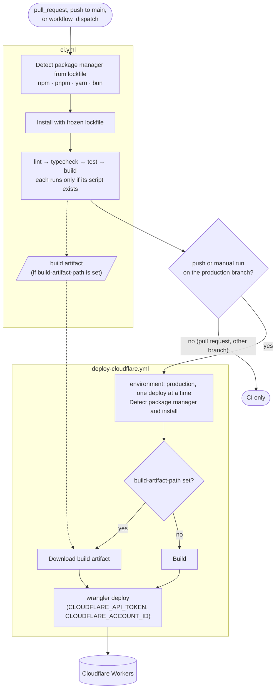
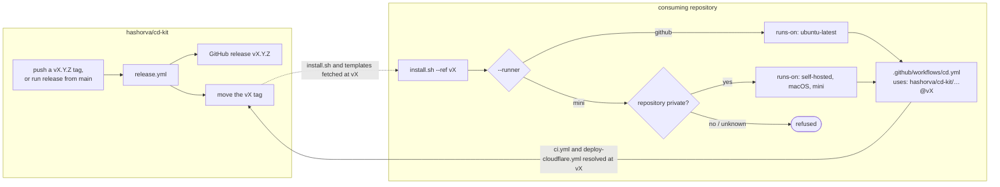

# cd-kit

Reusable, auto-installing continuous-deployment recipe extracted from [finduck](https://github.com/hashorva/finduck).

It packages versioned GitHub Actions reusable workflows and an installer for Zamir's other projects (Astro+EmDash, Vite, Tailwind, React, shadcn; Cloudflare Workers; GitHub; Mac mini runners for private repos, GitHub-hosted for public). Callers pin a release tag.

This repository is public. Public consumers stay on GitHub-hosted runners. Private consumers may pass self-hosted Mini runners through a `runs-on` input.

See [hashorva/finduck#237](https://github.com/hashorva/finduck/issues/237).

## How it works

The installer writes one caller workflow, `cd.yml`, into the consuming repository. It calls cd-kit's reusable workflows at the pinned tag: `ci.yml` on every run, then `deploy-cloudflare.yml` only for a push (or manual run) on the production branch.



Installing, choosing a runner and releasing tie the two repositories together. Callers pin `@vX`, which the `release` workflow moves to each new `vX.Y.Z`:



## Install

From the root of the consuming repository:

```sh
curl -fsSL https://raw.githubusercontent.com/hashorva/cd-kit/v0/install.sh | bash -s -- --ref v0
```

This writes `.github/workflows/cd.yml`, which runs CI on every pull request and push, and deploys to Cloudflare Workers on pushes to `main`. Then add the `CLOUDFLARE_API_TOKEN` and `CLOUDFLARE_ACCOUNT_ID` secrets (repository-level, or on the `production` environment).

| Option | Default | |
| --- | --- | --- |
| `--ref <tag>` | required | cd-kit tag to pin: `v0` follows the latest v0 release, `v0.1.0` is fixed |
| `--runner github\|mini` | `github` | `mini` uses `["self-hosted","macOS","mini"]` |
| `--runs-on <json>` | | explicit runner labels, overrides `--runner` |
| `--visibility public\|private` | detected with `gh` | self-hosted runners are refused for public repos |
| `--branch <name>` | `main` | branch that deploys to production |
| `--working-directory <dir>` | `.` | directory holding `package.json` |
| `--force` | | overwrite an existing `cd.yml` (use to upgrade) |
| `--dry-run` | | print instead of writing |

Private repo on the Mac mini:

```sh
curl -fsSL https://raw.githubusercontent.com/hashorva/cd-kit/v0/install.sh | bash -s -- --ref v0 --runner mini
```

## Reusable workflows

### `ci.yml`

Detects the package manager from the lockfile (npm, pnpm, yarn, bun), installs with a frozen lockfile, then runs `lint`, `typecheck`, `test` and `build`. Each phase runs the package.json script of that name when it exists and is skipped otherwise.

| Input | Default | |
| --- | --- | --- |
| `runs-on` | `'"ubuntu-latest"'` | JSON label or array |
| `working-directory` | `.` | |
| `node-version` / `node-version-file` | `22` / | the file wins when set |
| `lint-command`, `typecheck-command`, `test-command`, `build-command` | | override a phase; `-` skips it |
| `build-artifact-path` | | upload this path as the `build` artifact |

### `deploy-cloudflare.yml`

Installs, builds (or downloads the `build` artifact from `ci.yml`) and runs wrangler. One deploy per GitHub environment at a time.

| Input | Default | |
| --- | --- | --- |
| `runs-on`, `working-directory`, `node-version`, `node-version-file` | as above | |
| `environment` | `production` | GitHub environment |
| `wrangler-environment` | | wrangler `--env` |
| `wrangler-command` | `deploy` | e.g. `versions upload` for a preview |
| `wrangler-version` | | defaults to the project's wrangler |
| `build-command` | | as in `ci.yml` |
| `build-artifact-path` | | reuse the CI build instead of rebuilding |

Secrets: `CLOUDFLARE_API_TOKEN`, `CLOUDFLARE_ACCOUNT_ID`. Output: `deployment-url`.

## Releasing

Either push a `vX.Y.Z` tag, or run the `release` workflow from `main` (Actions → release → Run workflow) with the version; the latter tags the current `main` commit. The workflow publishes a GitHub release and moves the `vX` tag to it, so callers on `@vX` pick it up.

## Development

```sh
shellcheck install.sh tests/*.sh
actionlint
bash tests/install.sh
```

The `self-test` workflow runs the same checks, then installs into a scratch repo and lints the generated workflow.

## Sources

Origin: [hashorva/finduck#237](https://github.com/hashorva/finduck/issues/237).

GitHub Actions:

- [Reusing workflows](https://docs.github.com/en/actions/sharing-automations/reusing-workflows): `workflow_call` inputs, secrets and outputs, and calling a workflow pinned to a tag.
- [Workflow syntax](https://docs.github.com/en/actions/writing-workflows/workflow-syntax-for-github-actions): `runs-on`, `needs`, `if`, `permissions`, `defaults.run`.
- [Expressions](https://docs.github.com/en/actions/writing-workflows/choosing-what-your-workflow-does/evaluate-expressions-in-workflows-and-actions): `fromJSON`, used to pass `runs-on` as a JSON string.
- [Concurrency](https://docs.github.com/en/actions/writing-workflows/choosing-what-your-workflow-does/control-the-concurrency-of-workflows-and-jobs): one deploy per environment, pull-request runs cancelled when superseded.
- [Deployment environments](https://docs.github.com/en/actions/managing-workflow-runs-and-deployments/managing-deployments/managing-environments-for-deployment): the `production` environment, its protection rules and secrets.
- [Storing and sharing data from a workflow](https://docs.github.com/en/actions/writing-workflows/choosing-what-your-workflow-does/storing-and-sharing-data-from-a-workflow): the `build` artifact passed from CI to deploy.
- [About self-hosted runners](https://docs.github.com/en/actions/hosting-your-own-runners/managing-self-hosted-runners/about-self-hosted-runners) and [security hardening](https://docs.github.com/en/actions/security-for-github-actions/security-guides/security-hardening-for-github-actions): why self-hosted runners are refused for public repositories.
- [Action versioning](https://github.com/actions/toolkit/blob/main/docs/action-versioning.md): the `vX.Y.Z` release plus moving `vX` major tag convention.

Actions used: [actions/checkout](https://github.com/actions/checkout), [actions/setup-node](https://github.com/actions/setup-node), [oven-sh/setup-bun](https://github.com/oven-sh/setup-bun), [actions/upload-artifact](https://github.com/actions/upload-artifact), [actions/download-artifact](https://github.com/actions/download-artifact), [cloudflare/wrangler-action](https://github.com/cloudflare/wrangler-action).

Cloudflare and tooling:

- [Cloudflare Workers: GitHub Actions](https://developers.cloudflare.com/workers/ci-cd/external-cicd/github-actions/): API token and account ID secrets.
- [Wrangler commands](https://developers.cloudflare.com/workers/wrangler/commands/): `deploy`, `versions upload`, `--env`.
- [Corepack](https://nodejs.org/api/corepack.html): pnpm and yarn versions from `packageManager`.
- [actionlint](https://github.com/rhysd/actionlint) and [ShellCheck](https://www.shellcheck.net/): the self-test linters.
- [Mermaid flowcharts on GitHub](https://docs.github.com/en/get-started/writing-on-github/working-with-advanced-formatting/creating-diagrams): how the diagrams above render.

License: [PolyForm Shield 1.0.0](https://polyformproject.org/licenses/shield/1.0.0/).
