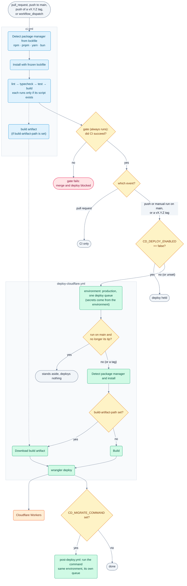
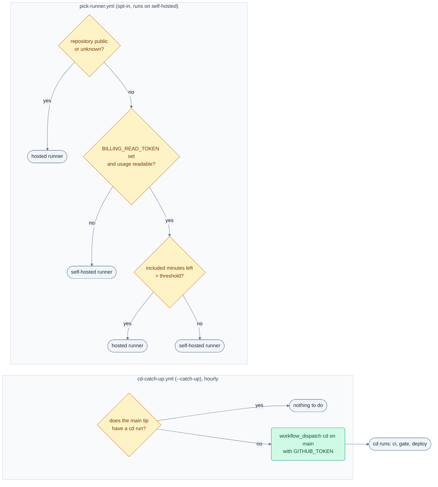
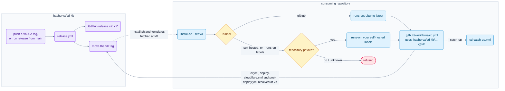

# cd-kit

Reusable, auto-installing continuous deployment for JavaScript and TypeScript projects that deploy to Cloudflare Workers.

It packages versioned GitHub Actions reusable workflows and an installer that adds them to any repository. CI detects npm, pnpm, Yarn or Bun and runs the project's own lint, typecheck, test and build scripts. Callers pin a release tag.

This repository is public. Public repositories stay on GitHub-hosted runners. Private repositories may pass their own self-hosted runner labels through a `runs-on` input.

## How it works

The installer writes one caller workflow, `cd.yml`, into the consuming repository. It calls cd-kit's reusable workflows at the pinned tag: `ci.yml` on every run, an always-running `gate` job that reports CI's result under one stable name, then `deploy-cloudflare.yml` for a push to the production branch or a `vX.Y.Z` tag. An older tag is a rollback. A deploy can be held with the repository variable `CD_DEPLOY_ENABLED=false` (unset deploys). After a successful deploy, `post-deploy.yml` runs the optional command in `CD_MIGRATE_COMMAND`.



Merges made with `GITHUB_TOKEN` (such as Dependabot auto-merge) start no workflow on `main`. The opt-in catch-up closes that gap, and the opt-in runner picker chooses hosted or self-hosted runners for a private repository:



Installing, choosing a runner and releasing tie the two repositories together. Callers pin `@vX`, which the `release` workflow moves to each new `vX.Y.Z`:



## Install

From the root of the consuming repository:

```sh
curl -fsSL https://raw.githubusercontent.com/hashorva/cd-kit/v0/install.sh | bash -s -- --ref v0
```

This writes `.github/workflows/cd.yml`, which runs CI on every pull request and push, and deploys to Cloudflare Workers on pushes to `main` and on `vX.Y.Z` tags. Then:

- Add `CLOUDFLARE_API_TOKEN` and `CLOUDFLARE_ACCOUNT_ID` as secrets on the `production` GitHub Environment only, so pull-request jobs never see them. On a public repo, limit that environment to the `main` branch and `v*` tags. Callers that still keep them as repository secrets can pass them with `secrets:` as before.
- Require the status check `gate` in the branch ruleset. A skipped reusable-workflow job reports as `ci`, not `ci / ci`, so requiring `ci` can block every pull request; `gate` always runs and fails unless CI succeeded.
- Do not set "Require deployments to succeed" on the branch ruleset: it blocks the merge that triggers the deploy.
- Create release tags in the GitHub Releases UI. A tag pushed with `GITHUB_TOKEN` does not start the deploy. Pushing an older tag is a rollback.
- Set `keep_vars: true` in the wrangler config (`keep_vars = true` in TOML) so a deploy does not wipe variables set in the dashboard.

| Option | Default | |
| --- | --- | --- |
| `--ref <tag>` | required | cd-kit tag to pin: `v0` follows the latest v0 release, `v0.1.0` is fixed |
| `--runner github\|self-hosted` | `github` | `self-hosted` uses `["self-hosted"]` |
| `--runs-on <json>` | | explicit runner labels, overrides `--runner` |
| `--visibility public\|private` | detected with `gh` | self-hosted runners are refused for public repos |
| `--branch <name>` | `main` | branch that deploys to production |
| `--working-directory <dir>` | `.` | directory holding `package.json` |
| `--catch-up` | off | also write `cd-catch-up.yml` (see below) |
| `--force` | | overwrite an existing `cd.yml` (use to upgrade) |
| `--dry-run` | | print instead of writing |

Private repo on your own self-hosted runners, targeting their labels:

```sh
curl -fsSL https://raw.githubusercontent.com/hashorva/cd-kit/v0/install.sh | bash -s -- --ref v0 --runs-on '["self-hosted","linux"]'
```

## Reusable workflows

### `ci.yml`

Detects the package manager from the lockfile (npm, pnpm, yarn, bun), installs with a frozen lockfile, then runs `lint`, `typecheck`, `test` and `build`. Each phase runs the package.json script of that name when it exists and is skipped otherwise.

| Input | Default | |
| --- | --- | --- |
| `runs-on` | `'"ubuntu-latest"'` | JSON label or array |
| `working-directory` | `.` | |
| `node-version` / `node-version-file` | `24` / | the file wins when set |
| `lint-command`, `typecheck-command`, `test-command`, `build-command` | | override a phase; `-` skips it |
| `build-artifact-path` | | upload this path as the `build` artifact |

### `deploy-cloudflare.yml`

Installs, builds (or downloads the `build` artifact from `ci.yml`) and runs wrangler. One deploy per GitHub environment at a time, queued and never cancelled. With `production-branch` set, a run that is no longer the tip of that branch stands aside before installing, so overlapping deploys cannot clobber each other.

| Input | Default | |
| --- | --- | --- |
| `runs-on`, `working-directory`, `node-version`, `node-version-file` | as above | |
| `environment` | `production` | GitHub environment |
| `wrangler-environment` | | wrangler `--env` |
| `wrangler-command` | `deploy` | e.g. `versions upload` for a preview |
| `wrangler-version` | | defaults to the project's wrangler |
| `build-command` | | as in `ci.yml` |
| `build-artifact-path` | | reuse the CI build instead of rebuilding |
| `production-branch` | | branch whose tip deploys; empty never stands aside (use it for tags) |

Secrets: `CLOUDFLARE_API_TOKEN`, `CLOUDFLARE_ACCOUNT_ID`, read from the job's GitHub Environment (optional to pass). Outputs: `deployment-url`, `deployed`.

### `post-deploy.yml`

Optional hook: runs one generic shell command after a successful deploy, from CI, in the same environment (so the Cloudflare secrets are in its environment variables) and in its own queue. Skipped when `command` is empty. Migrate from CI, never inside a request. The template passes the repository variable `CD_MIGRATE_COMMAND`.

| Input | Default | |
| --- | --- | --- |
| `command` | | shell command; empty skips the job |
| `runs-on`, `working-directory`, `node-version`, `node-version-file`, `environment` | as above | |

### `catch-up.yml`

Merges made with `GITHUB_TOKEN` (such as Dependabot auto-merge) start no `main` CI and no deploy. This job finds a branch tip with no run of the caller workflow and starts one with `workflow_dispatch`, which `GITHUB_TOKEN` may trigger. It needs no token of its own. Opt in with `install.sh --catch-up`, which writes an hourly `cd-catch-up.yml` (about 24 short runs a day; mind that on hosted minutes). Inputs: `branch` (`main`), `workflow` (`cd.yml`), `runs-on`.

### `pick-runner.yml`

For **private** repos: spend the included GitHub-hosted minutes first, then fall back to self-hosted. Opt in by calling it and passing its output to the other workflows; the installed template keeps a static `runs-on`.

```yaml
  pick:
    uses: hashorva/cd-kit/.github/workflows/pick-runner.yml@v0
    secrets:
      BILLING_READ_TOKEN: ${{ secrets.BILLING_READ_TOKEN }}
  ci:
    needs: pick
    uses: hashorva/cd-kit/.github/workflows/ci.yml@v0
    with:
      runs-on: ${{ needs.pick.outputs.runs-on }}
```

| Input | Default | |
| --- | --- | --- |
| `self-hosted-labels` | `'["self-hosted"]'` | runs the picker itself and is the fallback |
| `hosted-labels` | `'"ubuntu-latest"'` | used while minutes remain |
| `threshold` | `200` | hosted while more than this many included minutes remain |
| `included-minutes` | `0` | monthly included minutes; 0 infers them from the plan (free 2000, pro/team 3000, enterprise 50000) |

Secret `BILLING_READ_TOKEN`: a fine-grained personal access token with Plan: read, which you create. The picker runs on `self-hosted-labels`, never on a hosted runner (hosted jobs round up to a minute, and with a $0 budget a hosted picker cannot start). It falls back to self-hosted when the secret is missing, an API call fails or usage is unclear, and never outputs self-hosted labels for a public repo. Billing data lags by minutes to hours and is read per calendar month, so keep the threshold generous. Also set the Actions budget to $0 with stop-usage on (owner setting), so hosted minutes can never be billed. Keep `gate` and other required checks on a static runner that cannot disappear, such as your self-hosted labels.

## Releasing

Either push a `vX.Y.Z` tag, or run the `release` workflow from `main` (Actions → release → Run workflow) with the version; the latter tags the current `main` commit. The workflow publishes a GitHub release and moves the `vX` tag to it, so callers on `@vX` pick it up.

## Development

```sh
shellcheck install.sh tests/*.sh
actionlint
bash tests/install.sh
```

The `self-test` workflow runs the same checks, then installs into a scratch repo and lints the generated workflow. The `flowchart-check` workflow fails a pull request that changes `.github/workflows/` or `templates/` without changing this README; the `no-flowchart-change` label skips it for changes that do not alter behaviour. cd-kit's own workflows stay on GitHub-hosted runners.

## Sources

GitHub Actions:

- [Reusing workflows](https://docs.github.com/en/actions/sharing-automations/reusing-workflows): `workflow_call` inputs, secrets and outputs, and calling a workflow pinned to a tag.
- [Workflow syntax](https://docs.github.com/en/actions/writing-workflows/workflow-syntax-for-github-actions): `runs-on`, `needs`, `if`, `permissions`, `defaults.run`.
- [Expressions](https://docs.github.com/en/actions/writing-workflows/choosing-what-your-workflow-does/evaluate-expressions-in-workflows-and-actions): `fromJSON`, used to pass `runs-on` as a JSON string.
- [Concurrency](https://docs.github.com/en/actions/writing-workflows/choosing-what-your-workflow-does/control-the-concurrency-of-workflows-and-jobs): one deploy per environment, pull-request runs cancelled when superseded.
- [Deployment environments](https://docs.github.com/en/actions/managing-workflow-runs-and-deployments/managing-deployments/managing-environments-for-deployment): the `production` environment, its protection rules and secrets.
- [Storing and sharing data from a workflow](https://docs.github.com/en/actions/writing-workflows/choosing-what-your-workflow-does/storing-and-sharing-data-from-a-workflow): the `build` artifact passed from CI to deploy.
- [About self-hosted runners](https://docs.github.com/en/actions/hosting-your-own-runners/managing-self-hosted-runners/about-self-hosted-runners) and [security hardening](https://docs.github.com/en/actions/security-for-github-actions/security-guides/security-hardening-for-github-actions): why self-hosted runners are refused for public repositories.
- [Action versioning](https://github.com/actions/toolkit/blob/main/docs/action-versioning.md): the `vX.Y.Z` release plus moving `vX` major tag convention.

Actions used: [actions/checkout](https://github.com/actions/checkout), [actions/setup-node](https://github.com/actions/setup-node), [actions/github-script](https://github.com/actions/github-script), [oven-sh/setup-bun](https://github.com/oven-sh/setup-bun), [actions/upload-artifact](https://github.com/actions/upload-artifact), [actions/download-artifact](https://github.com/actions/download-artifact), [cloudflare/wrangler-action](https://github.com/cloudflare/wrangler-action).

Cloudflare and tooling:

- [Cloudflare Workers: GitHub Actions](https://developers.cloudflare.com/workers/ci-cd/external-cicd/github-actions/): API token and account ID secrets.
- [Wrangler commands](https://developers.cloudflare.com/workers/wrangler/commands/): `deploy`, `versions upload`, `--env`.
- [Corepack](https://nodejs.org/api/corepack.html): pnpm and yarn versions from `packageManager`.
- [actionlint](https://github.com/rhysd/actionlint) and [ShellCheck](https://www.shellcheck.net/): the self-test linters.
- [Mermaid flowcharts on GitHub](https://docs.github.com/en/get-started/writing-on-github/working-with-advanced-formatting/creating-diagrams): how the diagrams above render.

License: [PolyForm Shield 1.0.0](https://polyformproject.org/licenses/shield/1.0.0/).
